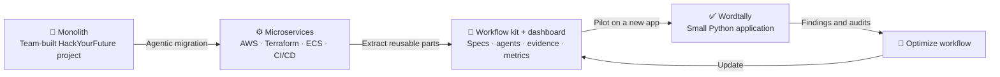

I build backend systems and experiment with how AI agents can do real production work. 

Before software I was a molecular biologist (MSc, partial PhD). I left research in 2023 and brought the same habits with me: form a hypothesis, measure what actually happens, and keep an honest record of both successes and failures.

## Current work: from migration to reusable AI workflow

I recently completed HackYourFuture’s backend track. My current work follows one connected engineering story:

### 🧱 1 · Migrate → JobMatch Microservices

→ [Dashboard](https://yusuprozimemet.github.io/jobmatch-microservices/) · [Lab notebook](https://github.com/Yusuprozimemet/jobmatch-microservices/blob/main/docs/lab-notebook.md) · [Repository](https://github.com/Yusuprozimemet/jobmatch-microservices)

### 🧩 2 · Extract → Agentic Workflow Kit
→ [Repository](https://github.com/Yusuprozimemet/agentic-workflow-kit)

### ✅ 3 · Pilot → Wordtally

→ [Live dashboard](https://yusuprozimemet.github.io/wordtally/) · [Lab notebook](https://github.com/Yusuprozimemet/wordtally/blob/main/docs/lab-notebook.md) · [Repository](https://github.com/Yusuprozimemet/wordtally)

---

## `$ cat projects.md`

### 🧩 JobMatch

A job-search platform developed by a six-person team as the final project at HackYourFuture. My contributions included Google sign-in, account deletion, the profile API, and job-matching logic.

→ [Live demo](https://c55c.hyf.dev/) · [Repository](https://github.com/HackYourFutureProjects/c55-final-project-group-C)

---

## `$ cat publication.bib`

Vincenzetti S, **Rozimemet Y**, et al. *NAD Metabolism and Proteomic Profile in a Yeast Model Expressing a Neurotoxic polyQ Protein.* [Preprints.org, 2024](https://www.preprints.org/manuscript/202402.1499)

**Outside code:** ♟ Chess · 🚴 Cycling · ✈️ Travel
